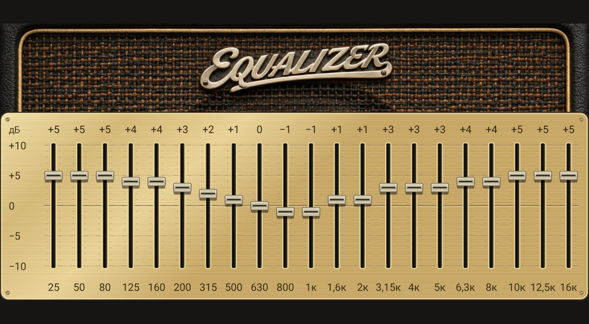
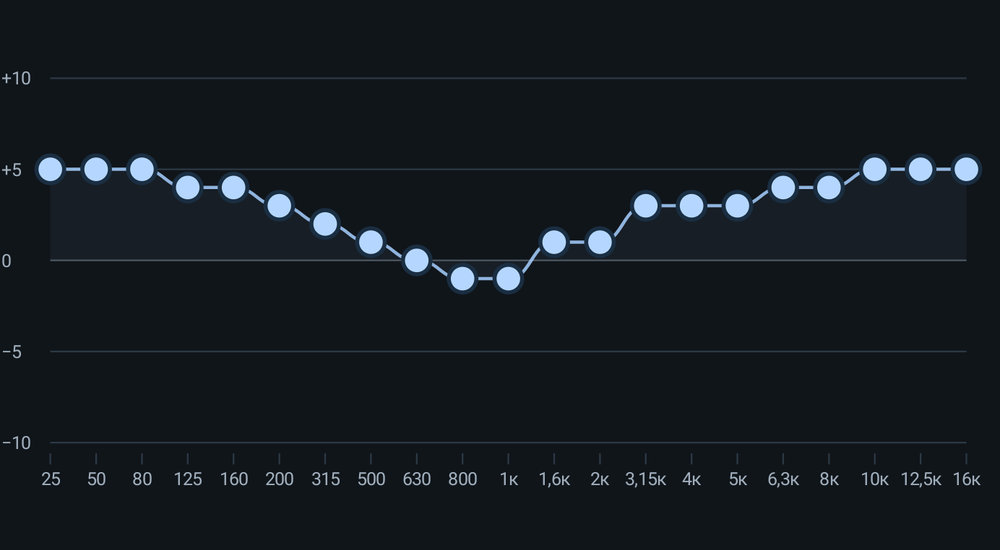
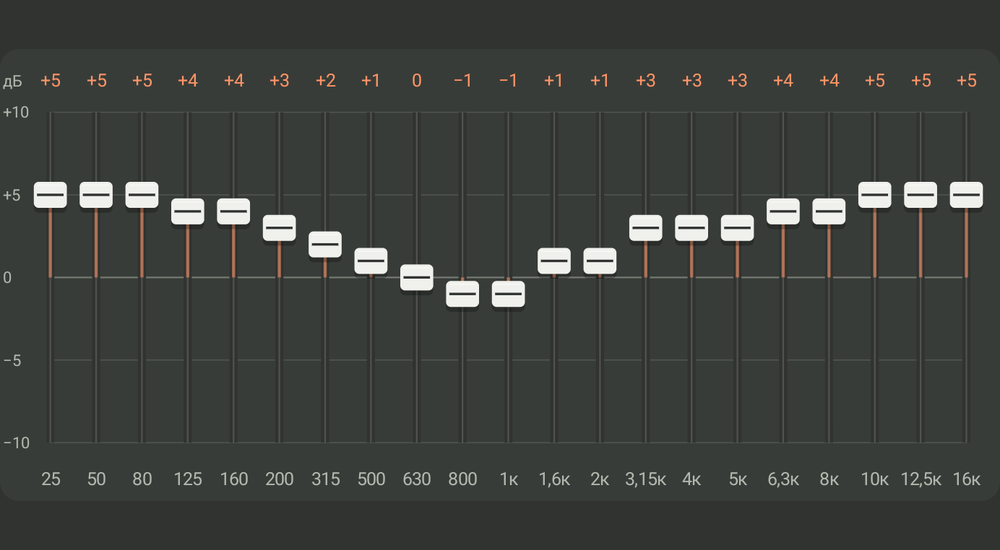
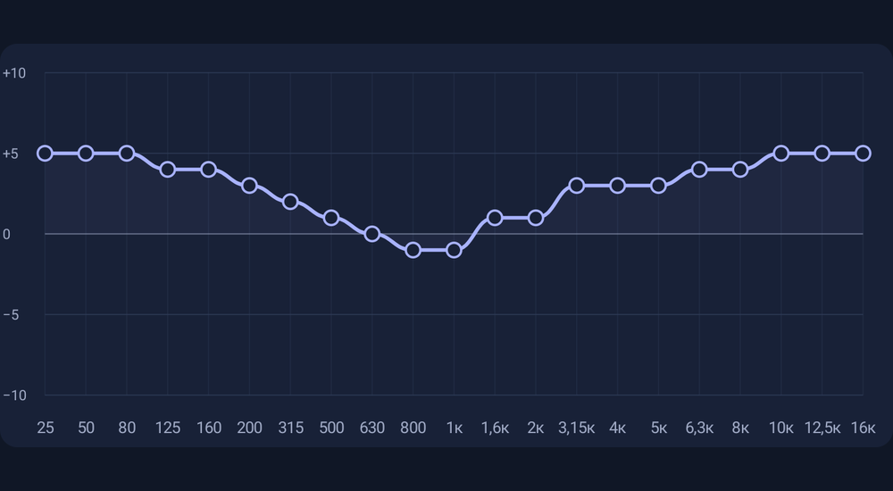
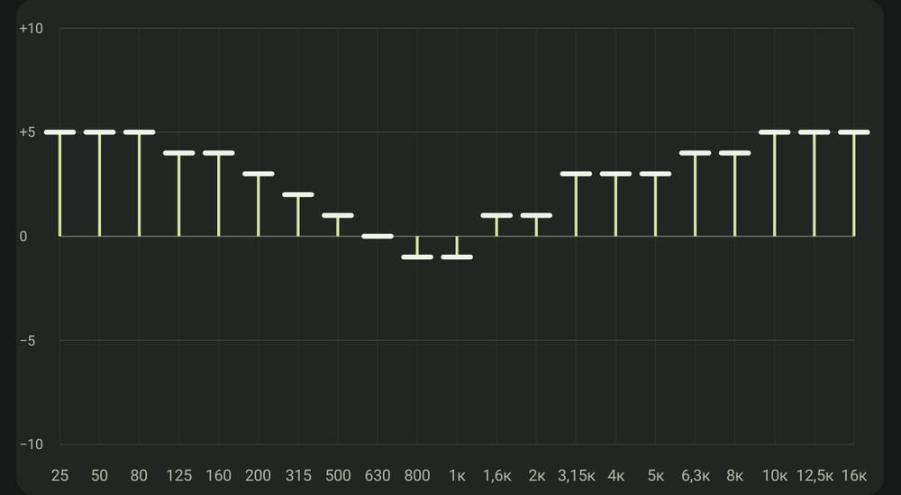

# Краткая инструкция к эквалайзеру Jeland J6

«Мой эквалайзер» настраивает звук музыки из Android Auto на Jeland J6. Начните с готового пресета или подберите уровни частот на слух.

## Возможности

- **Регулировка звука.** От 25 Гц до 16 кГц. Для быстрой настройки доступны 5 или 10 полос, для точной — 21.
- **Шесть готовых пресетов.** «Ровный», «Рок», «Поп», «Джаз», «Хип-хоп» и «Мягкий бас».
- **Свои пресеты.** Сохраняйте несколько вариантов звука под разными именами и переключайтесь между ними.
- **Автозапуск.** Выбранный пресет можно применять автоматически при запуске головного устройства.
- **Обновления.** Проверяйте и скачивайте новые версии из настроек приложения.

### Классический

Латунная панель с фейдерами под решёткой усилителя.

### Современный

Голубые точки на кривой. Потяните точку, чтобы изменить уровень.

### Студия

Светлые фейдеры на графитовой панели. Усиление каждой полосы указано сверху.

### Ночной контур

При касании сиреневой кривой появляются частота и усиление.

### Моно

Светлый штрих отмечает уровень полосы. Вертикальная линия показывает расстояние до нуля.

