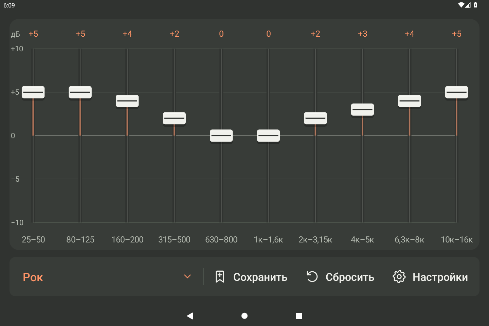
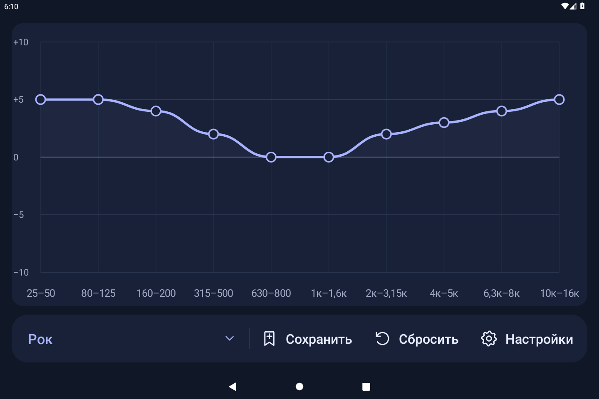
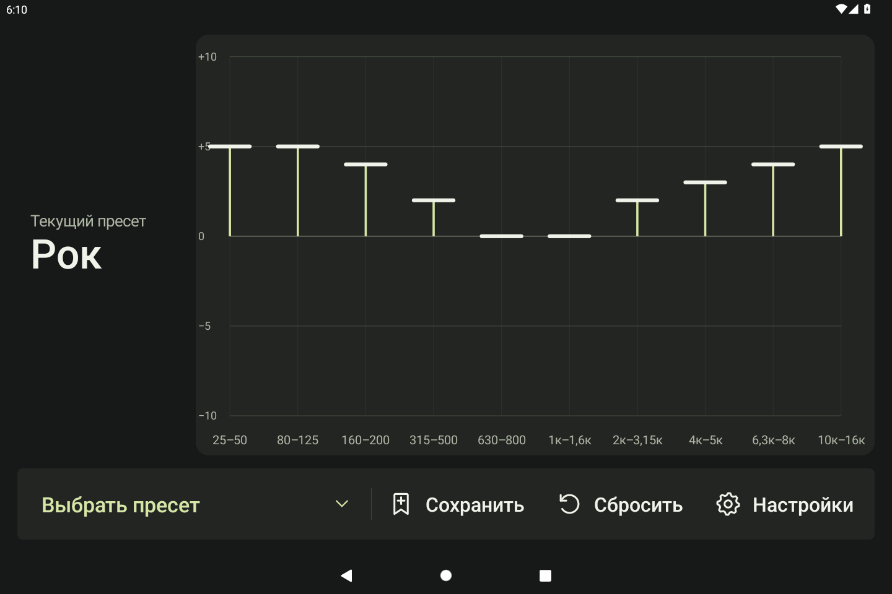
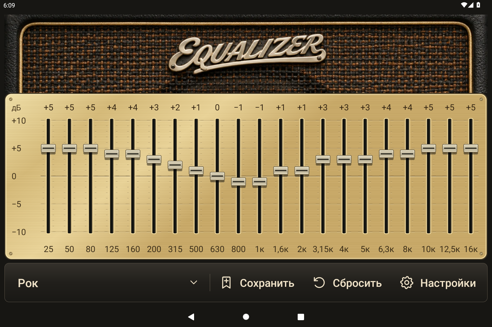
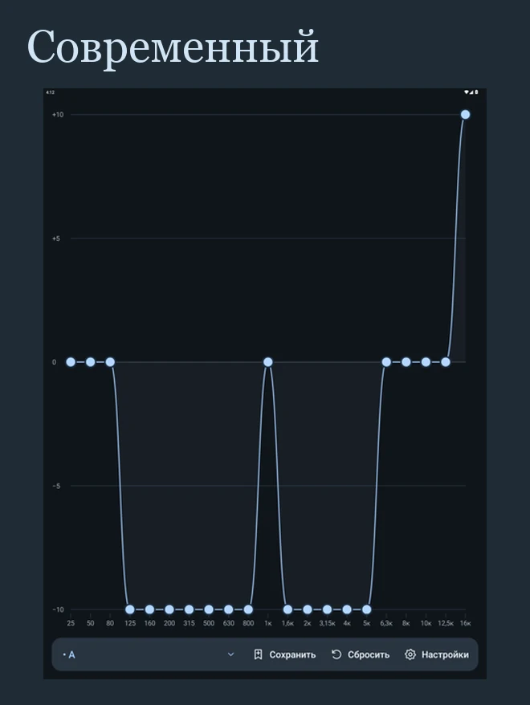

# 

Настраивайте звук по частотам от 25 Гц до 16 кГц. Можно провести пальцем вдоль всей кривой, поправить одну полосу или выбрать готовый пресет под музыку.

**[Скачать APK 0.7.46](https://github.com/plchkn/J6-Equalizer-releases/releases/download/v0.7.46/j6-equalizer-0.7.46.apk)** · [История версий](https://github.com/plchkn/J6-Equalizer-releases/releases) 
Для Android 12 и новее. APK доступен без входа в GitHub.

## Пять оформлений

В **Настройки → Оформление** сравните все пять тем на одной кривой. Смена темы сохраняет выбранный пресет и положение полос.

| Студия | Ночной контур | Моно |
| --- | --- | --- |
|  |  |  |
| Матовые ручки и оранжевые значения усиления. | Ведите пальцем по кривой, чтобы увидеть частоту и усиление. | Светлый штрих показывает уровень, цветная линия ведёт к нулю. |

В **«Классическом»** двигайте фейдеры на латунной панели комбика. В **«Современном»** тяните голубые точки на графике.

  
  

## Настройка под свою музыку

- **5, 10 или 21 полоса.** Пять полос удобны для быстрой настройки баса и высоких. Переключитесь на 21, чтобы точнее настроить отдельные частоты. При смене режима уровни сохраняются.
- **Шесть готовых пресетов.** Начните с «Ровного» для сравнения или попробуйте «Рок», «Поп», «Джаз», «Хип-хоп» и «Мягкий бас».
- **Свои пресеты.** Миниатюра рядом с названием показывает сохранённую кривую. Настройте звук, откройте список и нажмите «Создать новый». Дайте пресету имя. Чтобы позже записать изменения под тем же именем, нажмите «Сохранить» в редакторе.

## Установка и обновление

1. Откройте [последний выпуск](https://github.com/plchkn/J6-Equalizer-releases/releases/latest) и нажмите «Скачать APK». Файл с расширением `.apk` также есть в разделе **Assets**.
2. Откройте файл на устройстве и подтвердите установку. Если вы в дороге, дождитесь стоянки. Если приложение уже установлено, обновите его поверх прежней версии, чтобы сохранить пресеты и оформление.
3. Следующее обновление можно проверить из приложения. Откройте «Настройки» и прокрутите до раздела «Обновления».

Как проверить скачанный файл

Скачайте `SHA256SUMS` из того же выпуска и сравните указанную там сумму SHA-256 с суммой своего APK. Файл `update.json` использует само приложение при проверке обновлений.

