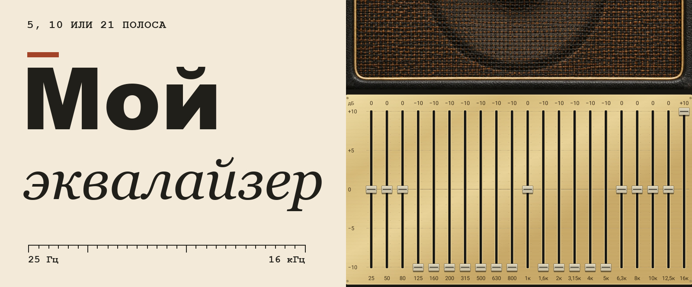
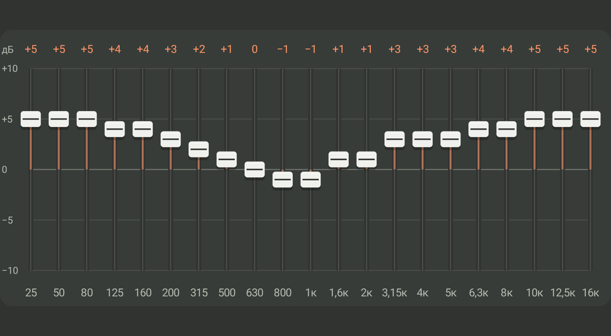

# 

**[Скачать APK 1.0.0](https://github.com/plchkn/J6-Equalizer-releases/releases/download/v1.0.0/j6-equalizer-1.0.0.apk)** · [Что нового в 1.0.0](https://github.com/plchkn/J6-Equalizer-releases/releases/tag/v1.0.0) · [Все версии](https://github.com/plchkn/J6-Equalizer-releases/releases)

Для Android 12 и новее.

«Мой эквалайзер» настраивает звук музыки из Android Auto на Jeland J6. Начните с готового пресета или подберите уровни частот на слух.

## Возможности

- **Регулировка звука.** От 25 Гц до 16 кГц. Для быстрой настройки доступны 5 или 10 полос, для точной — 21.
- **Шесть готовых пресетов.** «Ровный», «Рок», «Поп», «Джаз», «Хип-хоп» и «Мягкий бас».
- **Свои пресеты.** Сохраняйте несколько вариантов звука под разными именами и переключайтесь между ними.
- **Автозапуск.** Выбранный пресет можно применять автоматически при запуске головного устройства.
- **Обновления.** Проверяйте и скачивайте новые версии из настроек приложения.

## Пять оформлений

Откройте **Настройки → Оформление** и выберите тему. Уровни частот сохранятся. На всех снимках выбран пресет «Рок» с 21 полосой.

| Классический | Современный |
| --- | --- |
|  |  |
| Латунная панель с фейдерами под решёткой усилителя. | Голубые точки на кривой. Потяните точку, чтобы изменить уровень. |

| Студия | Ночной контур | Моно |
| --- | --- | --- |
|  |  |  |
| Светлые фейдеры на графитовой панели. Усиление каждой полосы указано сверху. | При касании сиреневой кривой появляются частота и усиление. | Светлый штрих отмечает уровень полосы. Вертикальная линия показывает расстояние до нуля. |

## Как настроить звук

1. Нажмите название пресета внизу слева и выберите профиль.
2. Коснитесь полосы и ведите палец вверх или вниз. Соседние полосы сохранят свой уровень, даже если палец сместится в сторону.
3. Нажмите «Сохранить», чтобы записать изменения. Для отдельной копии откройте список пресетов, нажмите «Создать новый», введите имя и нажмите «Создать».

## Установка и обновление

1. [Скачайте APK 1.0.0](https://github.com/plchkn/J6-Equalizer-releases/releases/download/v1.0.0/j6-equalizer-1.0.0.apk). Файл с расширением `.apk` также есть в разделе **Assets** на [странице последнего выпуска](https://github.com/plchkn/J6-Equalizer-releases/releases/latest).
2. Откройте файл на устройстве и подтвердите установку. Если вы в дороге, дождитесь стоянки. Если приложение уже установлено, обновите его поверх прежней версии, чтобы сохранить пресеты и оформление.
3. Следующее обновление можно проверить из приложения. Откройте «Настройки» и прокрутите до раздела «Обновления».

Как проверить скачанный файл

Скачайте [SHA256SUMS](https://github.com/plchkn/J6-Equalizer-releases/releases/download/v1.0.0/SHA256SUMS) и сравните указанную там сумму SHA-256 с суммой своего APK. Файл `update.json` использует само приложение при проверке обновлений.

[Открыть инструкцию отдельной страницей](GUIDE.md)
